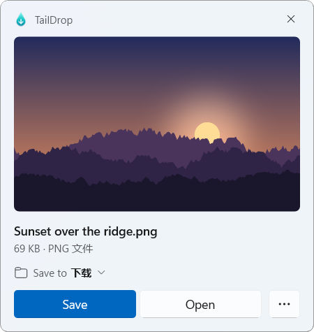
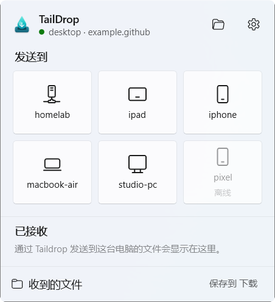
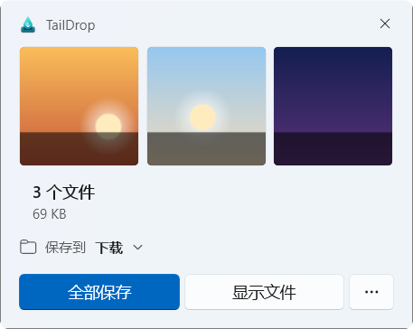
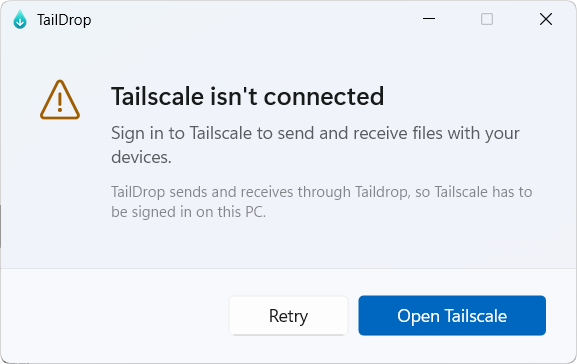
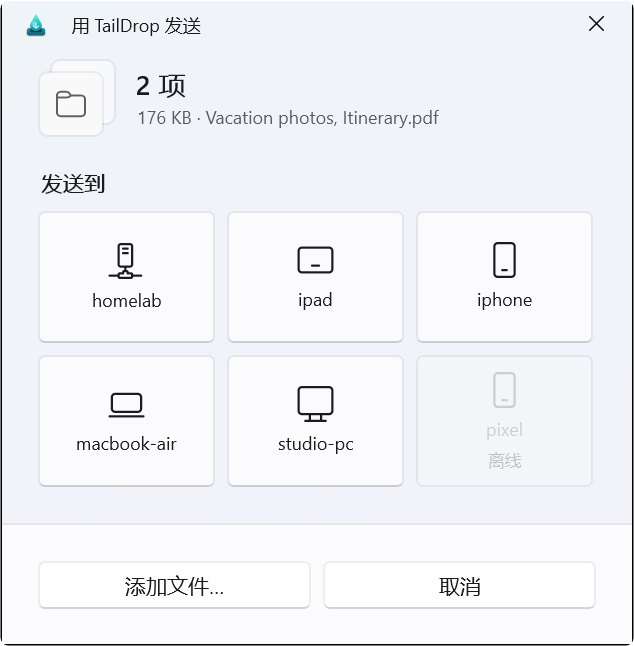
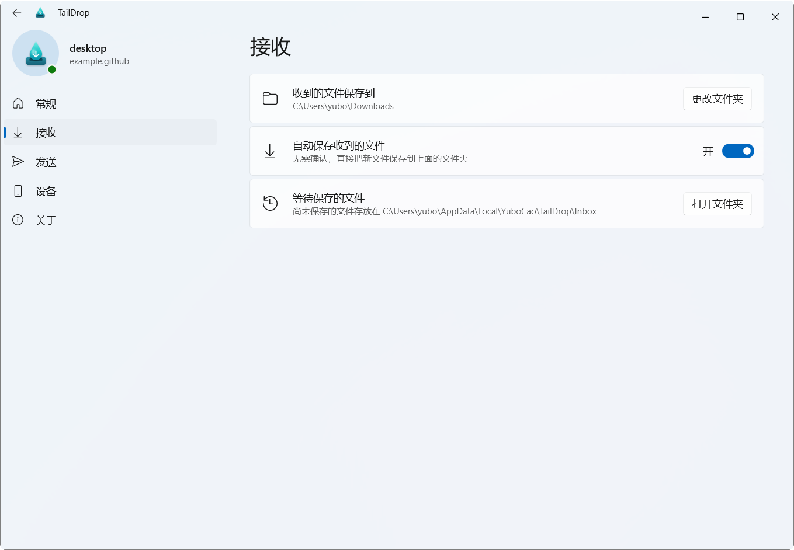
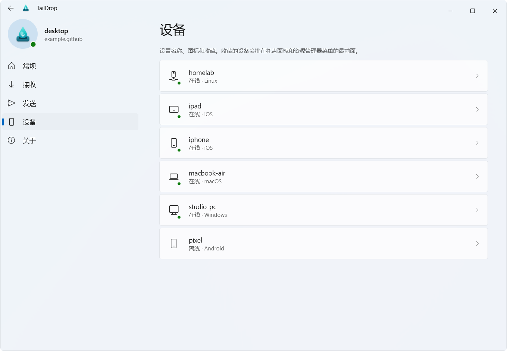
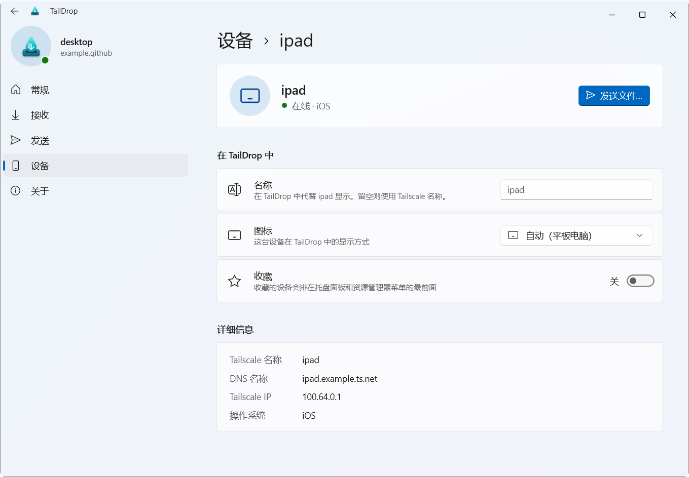

<p align="center"></p>

<h1 align="center">TailDrop</h1>

<p align="center">An AirDrop-style companion for <a href="https://tailscale.com/kb/1106/taildrop">Tailscale Taildrop</a> on Windows.<br>
A WinUI&nbsp;3 interface over a native listener that idles at about 2&nbsp;MB of memory.</p>

TailDrop sits in the system tray. When a phone, tablet or another computer sends this PC a file over Taildrop, a notification slides up with a preview of the file and asks where to put it. You can save it, open it, or drag the preview straight into any folder or app, because it's a real file. Sending works the same way in reverse: drop files on the tray icon, or right-click them in File Explorer and pick a device.

TailDrop is unofficial and not affiliated with Tailscale Inc. "Tailscale" and "Taildrop" are trademarks of Tailscale Inc.

<table>
  <tr>
    <td width="50%"></td>
    <td width="50%"></td>
  </tr>
  <tr>
    <td></td>
    <td></td>
  </tr>
  <tr>
    <td></td>
    <td></td>
  </tr>
  <tr>
    <td></td>
    <td></td>
  </tr>
</table>

<sub>Screenshots use demo device names, in the Chinese UI (TailDrop follows the Windows display language: English or Chinese).</sub>

## Features

**Receiving**
- A notification with a rendered preview (Explorer's own thumbnails, so photos, videos, PDFs and documents all work), the file's size and type, and a progress bar while it arrives.
- **Save** puts it in your default folder (Downloads unless you change it). The "Save to" line shows where it will go, and you can pick another folder for that transfer.
- Drag the preview anywhere: Explorer, the desktop, a chat window, an upload field. It is moved out of TailDrop's inbox like any other file.
- Several files sent together arrive in one notification. Anything you don't deal with stays in the inbox, shown in the tray flyout and marked on the tray icon.
- Optional automatic saving.

**Sending**
- Left-click the tray icon for the flyout: drop files on a device tile, or click a tile to choose files.
- Drag files onto the tray icon itself and a drop shelf opens above it.
- Right-click files or folders in File Explorer and choose **Send with TailDrop**. Up to three favorite devices appear directly in the submenu; **Other devices…** opens a picker with every device.
- Folders are sent as a `.zip` that is built while it uploads, so there is no temporary copy.
- Progress, speed, cancel and retry in the send notification.

**Devices**
- Each device gets an icon from its system and name (phone, tablet, laptop, desktop, server). On its page in Settings you can choose another icon and give it a name of your own.
- The Explorer submenu lists your favorites first, then the devices you sent to recently, then the rest (online first), up to three; **Other devices…** is always there.

**Everything else**
- If Tailscale isn't signed in or connected, TailDrop shows a window asking you to sign in, and the tray icon shows it.
- The interface is WinUI&nbsp;3, with its own controls and motion: Mica, the Windows 11 Settings layout with a sidebar and the title bar drawn into the window, light and dark mode, your accent color, per-monitor DPI, and the system file and folder pickers.

## Requirements

- Windows 10 2004 or later, or Windows 11, on x64.
- [Tailscale for Windows](https://tailscale.com/download/windows), signed in to your tailnet.

## Install

Download `TailDrop-<version>-Setup.exe` from [Releases](https://github.com/Yubo-Cao/taildrop/releases) and run it. Setup works per user and needs no administrator rights. It installs to `%LOCALAPPDATA%\Programs\TailDrop` and adds:

- the Explorer menu;
- a Start menu shortcut (**TailDrop (native)**);
- optionally, start at sign-in.

Uninstall it from Settings > Apps.

Without the setup program, extract the release `.zip` and run:

```powershell
powershell -ExecutionPolicy Bypass -File .\install.ps1
```

From source (see [Building](#building) for what it needs), run the same command in the repository; it builds first. `uninstall.ps1` removes a script install.

- **Windows 11 menu.** The new context menu only shows commands from apps with package identity, which TailDrop gets from a small sparse package. Windows accepts it only signed, or with **Developer Mode** on (Settings > System > For developers). Without either, the command is under **Show more options**. Install again after turning Developer Mode on.
- **Smart App Control.** While release binaries are unsigned (see [Code signing policy](#code-signing-policy)), Smart App Control blocks them. Turn it off in Windows Security > App & browser control > Smart App Control, or wait for a signed release.
- **Two notifications?** The Tailscale app shows its own "file received" notification. You can turn that off in Settings > System > Notifications > Tailscale.

Uninstalling keeps files still waiting in the inbox (`uninstall.ps1 -RemoveInbox` moves them to the Recycle Bin).

## How it works

TailDrop is two programs:

- `TailDrop.exe` is the part that always runs: tray icon, Tailscale connection, transfers, and the Explorer menu's backend. It is plain Win32 C++ with no UI framework, so it idles at about 2&nbsp;MB.
- `ui\TailDropUI.exe` draws every window: the tray flyout, notifications, Settings and the dialogs. It is WinUI&nbsp;3 (Windows App SDK, bundled, compiled ahead of time with .NET NativeAOT). TailDrop.exe starts it at sign-in and keeps it running (about 100&nbsp;MB), so the flyout opens at once however long it has been; if it exits or stops responding, TailDrop starts a new one. The two talk over a named pipe that only the current user can open.

The rest:

- TailDrop talks to the Tailscale service through its LocalAPI named pipe, so it never starts `tailscale.exe`. It subscribes to the service's notification stream for incoming transfers and device changes, so it does no polling.
- The Tailscale app for Windows saves every received file to Downloads right away. TailDrop matches the finished transfer to that file by name, size and time, moves it into its inbox (`%LOCALAPPDATA%\YuboCao\TailDrop\Inbox`, an instant rename on the same drive) and shows the notification. If the Tailscale app isn't running, TailDrop downloads waiting files from the service itself.
- Sending streams each file to the service (`PUT /localapi/v0/file-put/…`). Folders go through a small ZIP writer: stored entries, UTF-8 names, ZIP64 for large files.
- Notification-area icons can't receive drag-and-drop, so a low-level mouse hook notices a drag that reaches the icon and opens the drop shelf. You can turn this off in Settings.
- `TailDropShell.dll` implements `IExplorerCommand`. The classic menu loads it through a per-user COM registration; the Windows 11 menu loads it through the sparse package (`package/AppxManifest.xml`). The DLL only hands the selection to `TailDrop.exe`.

### Memory

`TailDrop.exe` has no window apart from a hidden message window, and no XAML, Direct2D or IME. It uses the segment heap, links the C runtime statically, and trims its working set once it has started and whenever the interface exits. Measured on Windows 11:

| State | Process | Working set | Private bytes |
| --- | --- | --- | --- |
| In the background | TailDrop.exe | 1.9 MB | 2.0 MB |
| Flyout open | TailDrop.exe | 3.6 MB | 2.0 MB |
| | TailDropUI.exe | 118 MB | 94 MB |
| A minute after the flyout closed | TailDrop.exe | 1.9 MB | 2.0 MB |

## Building

```powershell
.\build.ps1             # Release build into build\
.\build.ps1 -Config Debug
```

It needs Visual Studio 2022 or later with the Desktop C++ workload and a Windows 11 SDK, plus the .NET 10 SDK for the interface. The output is `TailDrop.exe`, `TailDropShell.dll`, `TailDrop.msix` (the sparse package) and `ui\` (the WinUI 3 interface, from `src/ui`). The setup program is built with [Inno Setup 6](https://jrsoftware.org/isinfo.php): `iscc installer\TailDrop.iss` writes `dist\TailDrop-<version>-Setup.exe`. Icons are generated: `python tools/make_icons.py` (needs Pillow) rewrites `assets/` and `package/Assets/`. `tools/shelltest.cpp` exercises the Explorer command the way File Explorer does.

Set `TAILDROP_LOG=1` before starting TailDrop to log to `%LOCALAPPDATA%\YuboCao\TailDrop\taildrop.log` (and the interface to `%TEMP%\TailDropUI.log`). `TAILDROP_DEMO=1` shows made-up devices instead of your tailnet's and leaves the inbox and the Explorer menu alone, for screenshots. `TAILDROP_DEMO=offline` previews the signed-out screens.

## Code signing policy

Release builds are produced by the [GitHub Actions workflow](.github/workflows/build.yml) from this repository's source. Signing them through the free open-source program of [SignPath Foundation](https://signpath.org) (free code signing provided by SignPath.io, certificate by SignPath Foundation) is being set up. Until it is active, releases are unsigned.

Team roles:

- Committers and reviewers: [Yubo Cao](https://github.com/Yubo-Cao)
- Approvers: [Yubo Cao](https://github.com/Yubo-Cao)

### Privacy policy

This program will not transfer any information to other networked systems unless specifically requested by the user or the person installing or operating it. TailDrop only talks to the Tailscale service on your PC; files are sent to the devices you choose, through Taildrop.

## License

[MIT](LICENSE)
